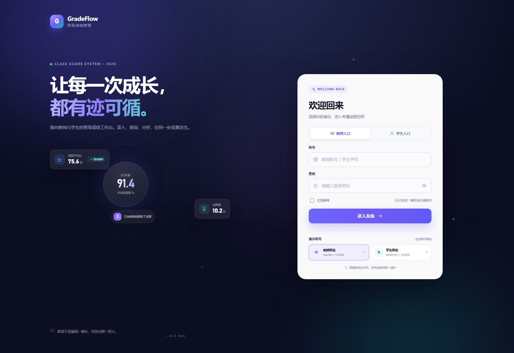
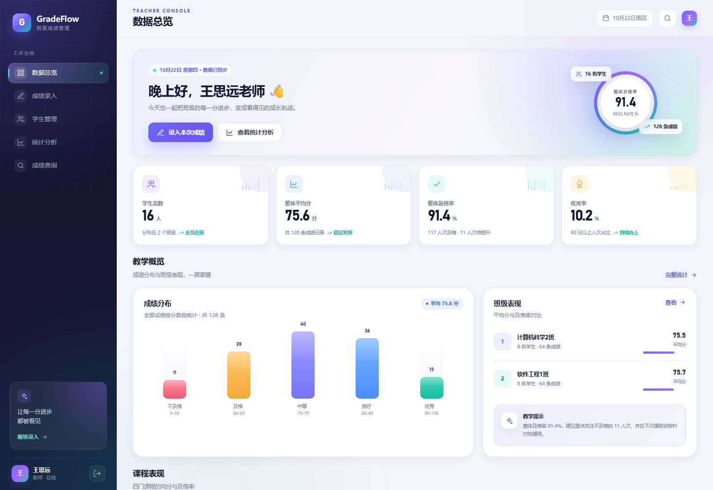
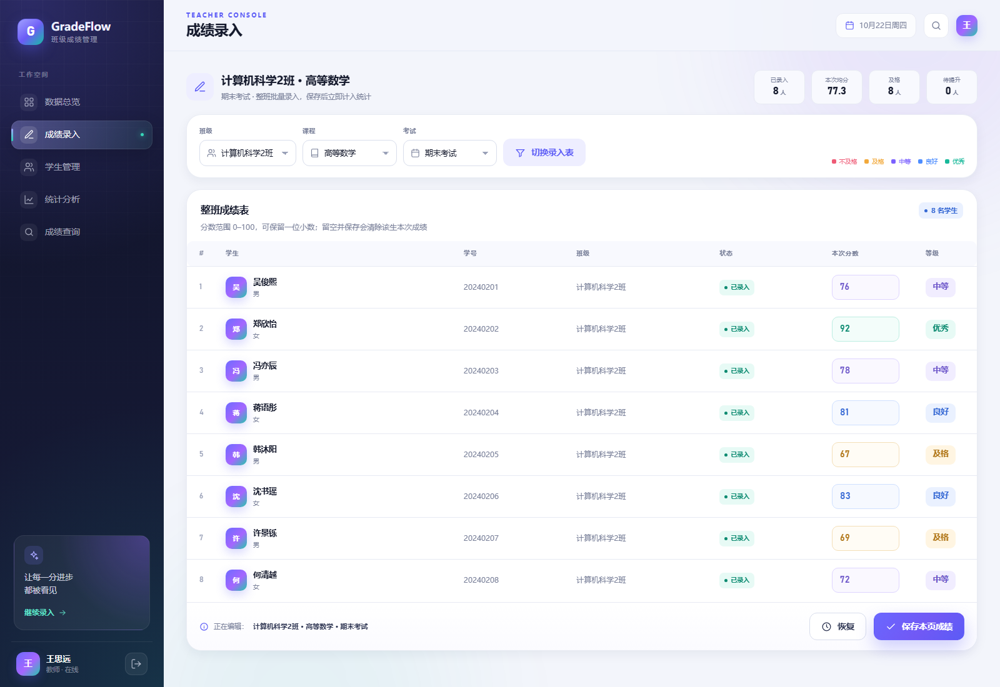
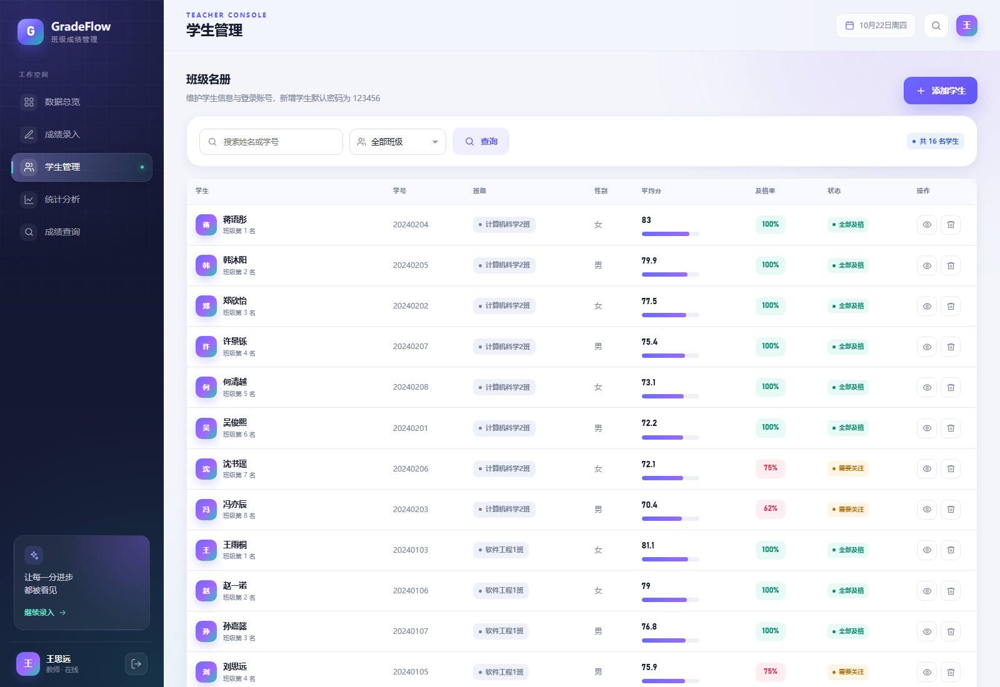
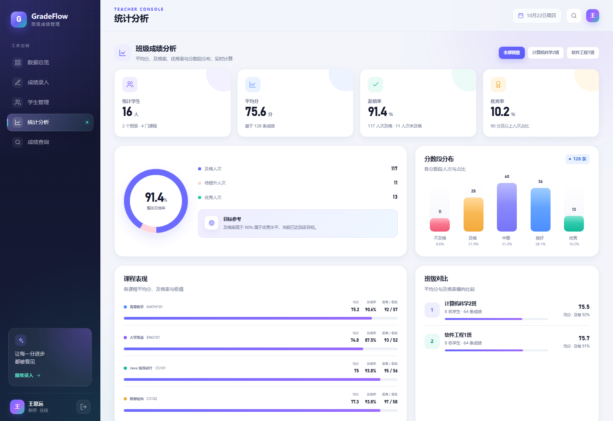
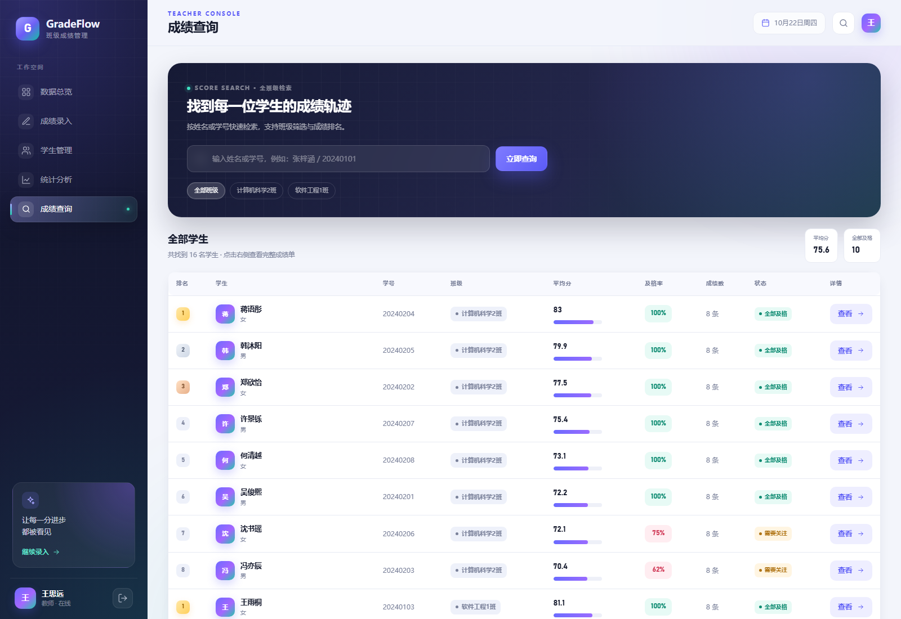
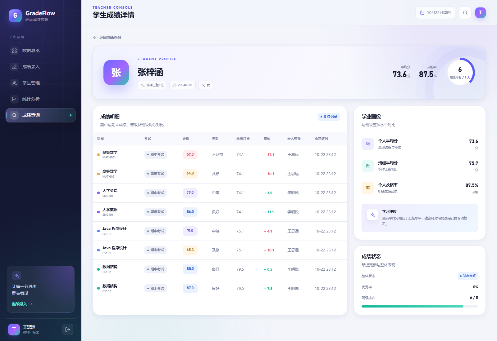
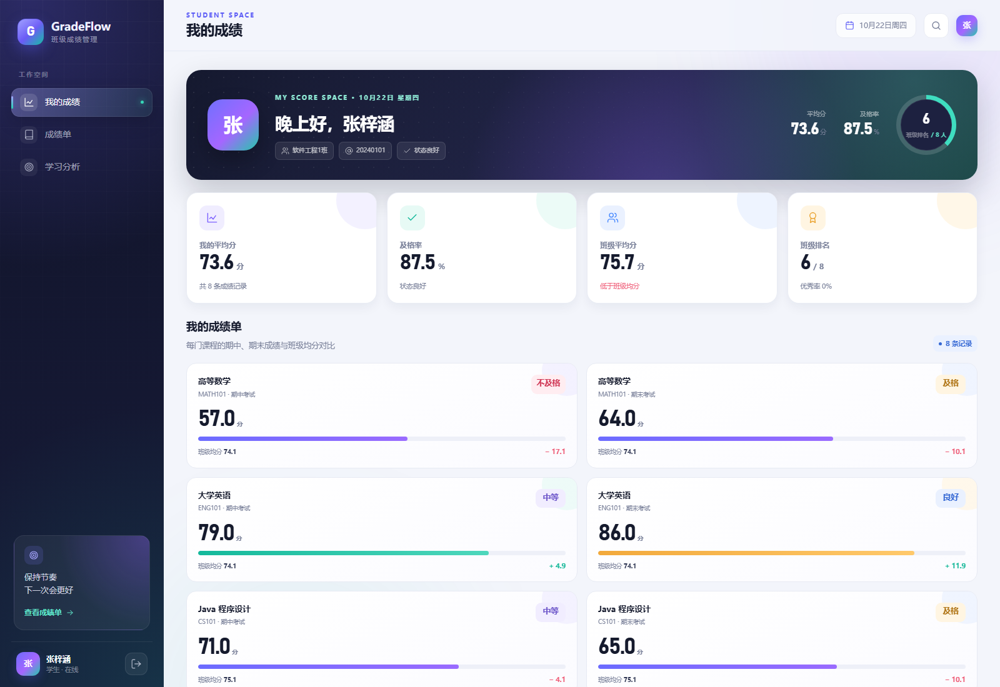

# GradeFlow · 班级学生成绩管理系统

一个可直接运行的 JavaEE 课程设计项目：Servlet + JSP + JSTL + H2 文件数据库，部署在 Tomcat 9。包含教师成绩录入、学生成绩查询、平均分 / 及格率 / 优秀率统计、成绩分布、班级排行，以及完整的登录鉴权与页面动画。

> 项目位置：`D:\javaproject\ClassScoreManager`  
> 访问地址：**http://localhost:8080/classscore/**  
> 教师账号：`teacher / 123456`  
> 学生账号：`20240101 / 123456`（其余学生用学号登录，密码同为 `123456`）



## 一、功能清单

| 模块 | 功能 |
| --- | --- |
| 登录鉴权 | 教师 / 学生双入口，PBKDF2 加盐密码，Session 登录，角色越权拦截 |
| 教师总览 | 学生数、平均分、及格率、优秀率、成绩分布、班级对比、课程表现、排行榜、最近录入 |
| 成绩录入 | 按班级 + 课程 + 考试整班批量录入；实时计算本次均分、及格/待提升人数；留空保存即删除该条成绩 |
| 学生管理 | 学生名册、姓名/学号搜索、按班级筛选、新增学生（自动创建登录账号）、删除学生 |
| 统计分析 | 平均分、及格率、优秀率、分数段分布、课程对比、班级对比、Top 8 排行、教学建议 |
| 成绩查询 | 教师按姓名/学号/班级查询，查看单个学生完整成绩单与班级均分对比 |
| 学生端 | 本人平均分、及格率、班级排名、每门课成绩卡、与班级均分对比、学习建议 |
| 视觉交互 | 登录页极光/轨道动画、数字滚动、卡片入场、柱状图生长、Toast、模态框、跨页面平滑过渡、响应式布局 |

## 二、技术栈与环境

| 项目 | 版本 / 说明 |
| --- | --- |
| 运行 JDK | `D:\java`（OpenJDK 24.0.2，IntelliJ 已注册为 `24`） |
| 编译 JDK | `C:\Program Files\Microsoft\jdk-17.0.12.7-hotspot`（`--release 17`） |
| Web 容器 | Apache Tomcat `9.0.122`，`D:\apache-tomcat-9.0.122-windows-x64\apache-tomcat-9.0.122` |
| Servlet / JSP | Servlet 4.0 / JSP 2.3（`javax.servlet`） |
| 数据库 | H2 2.2.224 文件模式，启动自动建表并写入演示数据 |
| 前端 | 原生 HTML / CSS / JavaScript，无 CDN、无构建工具依赖 |
| IDE | IntelliJ IDEA 2026.2.3，已配置 Web Facet、Exploded WAR 工件、Tomcat 9 运行配置 |

## 三、目录结构

```text
ClassScoreManager/
├─ src/com/classscore/
│  ├─ dao/             JDBC 数据访问（User / Student / Course / Score / Stats）
│  ├─ filter/          UTF-8 编码过滤器、登录与角色权限过滤器
│  ├─ listener/        应用启动时初始化 H2 数据库
│  ├─ model/           实体与统计 DTO
│  ├─ service/         登录、成绩、统计业务
│  ├─ servlet/         登录 / 退出 / 学生端
│  ├─ servlet/teacher/ 教师端 5 个 Servlet
│  └─ util/            H2 初始化与种子数据、密码哈希、Web 工具
├─ web/
│  ├─ assets/css/app.css   全部视觉、动画、响应式样式
│  ├─ assets/js/app.js     页面过渡、数字滚动、成绩实时统计、弹窗等
│  ├─ WEB-INF/views/       JSP 页面（登录 / 教师 / 学生 / 错误页）
│  ├─ WEB-INF/jspf/        公共头部、底部、SVG 图标库
│  ├─ WEB-INF/lib/         h2-2.2.224.jar、jstl-1.2.jar
│  └─ WEB-INF/web.xml
├─ data/               H2 数据文件（运行后生成，可删除重置）
├─ dist/               ClassScoreManager.war
├─ out/artifacts/      IntelliJ exploded-war 工件输出
├─ docs/screenshots/   页面验收截图
├─ .idea/              IntelliJ 项目、工件、Tomcat 运行配置
├─ build.ps1           编译 + 复制 Web 资源 + 打包 WAR
├─ deploy.ps1          停止旧实例 + 部署 + 启动 + 健康检查
├─ run-tomcat.bat      前台运行 Tomcat（供隐藏启动器调用）
├─ launch-tomcat.vbs   无窗口启动器
├─ Start-Tomcat.lnk    双击隐藏启动 Tomcat（推荐）
├─ start.bat           一键启动 Tomcat 并打开浏览器（可见窗口）
└─ stop.bat            停止 Tomcat
```

## 四、运行方式

### 方式 1：IntelliJ IDEA（当前推荐，8081）

1. 用 IntelliJ IDEA 打开 `D:\javaproject\ClassScoreManager`，等待索引完成。
2. 项目 SDK 使用已注册的 `24`，语言级别 17；Tomcat 服务器为 `Tomcat -9.0.122`。
3. 右上角运行配置选择 **Tomcat 9 · ClassScoreManager (8081)**；IDEA 自动生成的 `Tomcat -9.0.122` 也已修正为同样的部署路径。
4. 点击绿色运行按钮，访问 <http://localhost:8081/classscore/>。
5. 工件：`ClassScoreManager:war exploded`，Context：`/classscore`，输出在 `out\artifacts\ClassScoreManager_war_exploded`。
6. 如果运行配置下拉框里还没有新配置，重启一次 IDEA 即可加载 `.idea/runConfigurations/Tomcat_9_ClassScoreManager.xml`。

### 方式 2：独立 Tomcat 服务（8080）

`classscore.war` 已部署到 Tomcat 9，但当前已停止，以避免与 IDEA 抢 8080 端口和 H2 数据文件。

- **启动**：双击 `Start-Tomcat.lnk`（隐藏窗口），访问 <http://localhost:8080/classscore/>。
- **启动并打开浏览器**：双击 `start.bat`。
- **停止**：双击 `stop.bat`，或在 IDEA 的 Tomcat 运行窗口点击停止。

> **重要：IDEA 的 8081 与独立服务的 8080 只能同时运行一个。**  
> H2 是文件数据库，两个 Tomcat 同时启动会报“数据库正被另一个 Tomcat 占用”或“地址 8080 已在使用中”。遇到时先停止其中一个再启动另一个。

### 方式 3：重新构建并部署

```powershell
cd D:\javaproject\ClassScoreManager
powershell -ExecutionPolicy Bypass -File .\build.ps1
powershell -ExecutionPolicy Bypass -File .\deploy.ps1
```

`build.ps1` 会自动使用本机 JDK 17 编译、复制 Web 资源并打包 `dist\ClassScoreManager.war`；`deploy.ps1` 会停止旧 Tomcat、复制 WAR、启动并等待首页返回 200。

## 五、数据库说明

- 数据库：H2 文件模式，路径 `D:\javaproject\ClassScoreManager\data\classscore.mv.db`。
- 首次启动自动建表：`teacher`、`course`、`student`、`score`、`app_user`。
- 演示数据：2 个班级、16 名学生、4 门课程、2 次考试、128 条成绩；其中包含少量不及格记录，便于查看及格率与预警效果。
- 表结构要点：
  - `score` 对 `(student_id, course_id, exam_name)` 建唯一键，批量录入使用 H2 `MERGE` 做 upsert。
  - 删除学生时级联删除成绩，并同步删除其登录账号。
  - 密码只保存 `pbkdf2$迭代次数$盐$哈希`，不保存明文。
- 重置数据：停止 Tomcat → 删除 `data` 目录 → 重新启动，系统会重新生成演示数据。

## 六、统计口径

- 平均分：`AVG(score)`，保留 1 位小数显示。
- 及格率：`score >= 60` 的记录数 / 总记录数 × 100%。
- 优秀率：`score >= 90` 的记录数 / 总记录数 × 100%。
- 班级排名：同一班级内按全部成绩平均分降序，分数相同共享名次；无成绩不参与排名。
- 成绩分布：0–59、60–69、70–79、80–89、90–100 五段。

## 七、动画与页面切换

- 跨文档 **View Transitions**（Chromium：`@view-transition { navigation: auto; }`）实现页面淡入淡出与轻微位移动画。
- 不支持 View Transitions 的浏览器自动降级为遮罩式页面过渡。
- 数字滚动（IntersectionObserver + requestAnimationFrame）。
- 卡片入场错峰、柱状图生长、进度条缩放、Toast 进出、模态框弹性打开。
- 支持 `prefers-reduced-motion`，系统开启“减少动态效果”时自动降级。

## 八、安全与边界

- 密码 PBKDF2-HMAC-SHA256，10 万次迭代、随机盐。
- 登录成功后销毁旧 Session，防止会话固定。
- `AuthFilter` 对 `/teacher/*`、`/student/*` 做角色校验；学生端只使用 Session 中的 `refId` 查询本人数据，不接受前端传入的 `studentId`。
- 全部 SQL 使用 `PreparedStatement`；JSP 输出使用 `<c:out>` 转义。
- 响应头包含 `X-Content-Type-Options`、`X-Frame-Options`、`Referrer-Policy`。
- 本项目为课程设计/本机演示用途，未接入 HTTPS、CSRF Token 与生产级连接池；正式部署时应补充。

## 九、常见问题

**Q：IDEA 运行时报“地址 localhost:8080 已在使用中”？**  
A：说明独立 Tomcat 正在跑 8080。先双击 `stop.bat`，再在 IDEA 里运行；IDEA 默认使用 **8081**，访问 <http://localhost:8081/classscore/>。

**Q：IDEA 报 “Database may be already in use / The file is locked”？**  
A：同一个 H2 数据文件被两个 Tomcat 同时打开了。IDEA 的 Tomcat 和独立 Tomcat 只能开一个；在 IDEA 里停止 Tomcat，或双击 `stop.bat`，然后重新运行。

**Q：IDEA 日志提示找不到 `META-INF/context.xml`？**  
A：已通过 `web/META-INF/context.xml` 修复。若仍提示，执行一次 `Build → Build Artifacts → Rebuild`，或运行 `build.ps1` 后重启 IDEA。

**Q：页面 404 / 访问不到？**  
A：确认 Tomcat 9 已启动、`webapps\classscore.war` 存在；独立服务访问 `/classscore/`，IDEA 运行访问 `http://localhost:8081/classscore/`，不要漏掉上下文路径。

**Q：启动脚本提示 JAVA_HOME？**  
A：`start.bat` 和 `deploy.ps1` 内已设置 `JAVA_HOME=D:\java`，不依赖系统环境变量。IntelliJ 运行配置中也已设置。

**Q：想换成 MySQL？**  
A：当前实现刻意使用 H2 做到“零配置运行”。若课程要求 MySQL，可将 `Database` 的连接 URL / 驱动替换为 MySQL，并把建表语句迁移到 MySQL 8；DAO 层使用标准 JDBC，改动集中在 `com.classscore.util.Database`。

## 十、验收截图

| 页面 | 截图 |
| --- | --- |
| 登录 |  |
| 教师总览 |  |
| 成绩录入 |  |
| 学生管理 |  |
| 统计分析 |  |
| 成绩查询 |  |
| 学生详情 |  |
| 学生端 |  |
